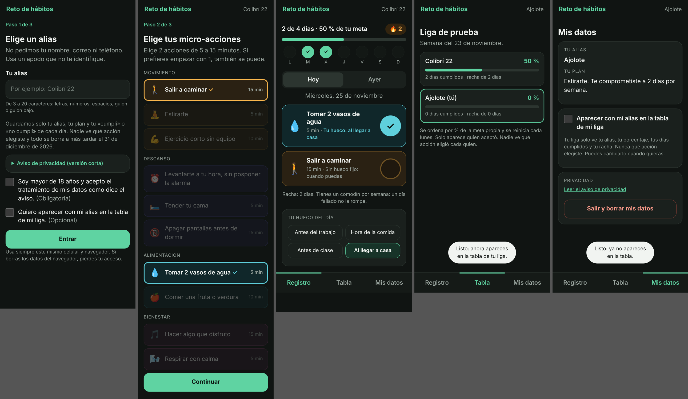

# Reto de hábitos

Página web de reto por cohorte para personas que trabajan y estudian. Cada quien entra con un alias, elige 1 o 2 micro-acciones de 5 a 15 minutos, declara el hueco de su día, marca sí o no cada día y ve una tabla que premia cumplir **su propia meta**, no quién hace más.

Proyecto del Hackathon «Tendencias en nuevas tecnologías» (EBC, 2026). El nombre «Reto de hábitos» es provisional.

**Versión 0.2 (25 de noviembre de 2026).** Cubre las historias 1 a 11 del backlog: la iteración 1 (historias 1 a 6) y, por adelantado, la iteración 2 (historias 7 a 11).



## Qué hay en este repositorio

| Ruta | Qué es |
|---|---|
| `index.html`, `css/`, `js/app.js` | La página. Es estática: se publica tal cual con GitHub Pages |
| `js/config.js` | URL y llave **publicable** de Supabase, y los datos del aviso de privacidad |
| `aviso.html` | Aviso de privacidad completo (borrador) |
| `supabase/schema.sql` | Base de datos: tablas, reglas de acceso y funciones |
| `pruebas/` | Pruebas automáticas de la base de datos y de la página |
| `bitacora/` | Bitácora de proyecto, una entrada por iteración |

## Cómo funciona

- **Sin servidor propio.** La página habla directo con Supabase. El alta usa el acceso anónimo de Supabase: no hay nombre, correo ni teléfono.
- **Las reglas viven en la base de datos.** Nadie escribe directo en las tablas; todo pasa por funciones que validan: solo se registra hoy y ayer, el día se calcula con la hora de la Ciudad de México, cada persona solo lee sus propios registros y la tabla de la liga nunca dice qué acción hizo cada quien.
- **Sorteo del hueco.** Quien elige 2 acciones recibe un sorteo: una lleva hueco del día y la otra no. Sirve para medir si el hueco ayuda.
- **% de la meta propia** = días cumplidos de la semana entre días comprometidos, con tope de 100 %. La semana empieza el lunes.

## Puesta en marcha

1. **Supabase.** Crear un proyecto. En *Authentication > Sign In / Providers*, activar **Allow anonymous sign-ins**.
2. **Base de datos.** En *SQL Editor*, pegar todo `supabase/schema.sql` y correrlo. Se puede correr varias veces.
3. **Configuración.** Copiar la *Project URL* y la llave *publishable* (`sb_publishable_...`) a `js/config.js`.
4. **Publicar.** En GitHub: *Settings > Pages > Deploy from a branch > main / (root)*.
5. **Probar.** Abrir `https://<usuario>.github.io/<repositorio>/?c=PRUEBA` desde un celular.
6. **Cerrar la cohorte de prueba.** `PRUEBA` aparece en este repositorio público, así que cualquiera podría usarla. Después de probar, poner `cohortes.abierta = false` en `PRUEBA` y crear una cohorte con un código privado que **no** se escriba en el repositorio. El código del enlace funciona como contraseña de registro.

## Operación (desde el panel de Supabase, *Table Editor*)

| Para… | Se hace así |
|---|---|
| Crear la cohorte real | Nueva fila en `cohortes` con un `codigo` en MAYÚSCULAS difícil de adivinar. El enlace de invitación es `.../?c=CODIGO` |
| Cerrar las altas | `cohortes.abierta = false` |
| Crear ligas | Nuevas filas en `ligas` con la `cohorte` y un `nombre` |
| Asignar a alguien a una liga | Poner el `id` de la liga en `participantes.liga_id` |
| Encender o apagar la tabla de una liga | `ligas.tabla_encendida` |
| Marcar a los integrantes del equipo | `participantes.es_equipo = true` (se reportan aparte) |
| Dar de baja a alguien (si no puede usar el botón «Salir y borrar mis datos») | Borrar su usuario en *Authentication > Users*; sus datos se borran en cascada |

## Reglas del repositorio

- **Nunca** se sube la llave secreta (`sb_secret_...`), la contraseña de la base de datos ni datos reales.
- La llave publicable sí puede estar en `js/config.js`: está hecha para verse en el navegador y solo permite lo que las reglas de acceso dejan.
- Las capturas de la bitácora y del mural usan solo datos de prueba o resultados agregados, nunca alias reales.

## Pruebas

```
cd pruebas
npm install
npm test
```

`probar-sql.mjs` corre `schema.sql` en un Postgres local y revisa las reglas (66 comprobaciones). `probar-pagina.mjs` abre la página en un navegador con tamaño de celular y recorre el flujo completo contra ese mismo Postgres (59 comprobaciones). En las dos, la autenticación de Supabase está simulada: la prueba con el Supabase real se hace a mano con el enlace `?c=PRUEBA`.

## Pendientes y decisiones abiertas

- **Qué cuenta como «día cumplido» con 2 acciones.** Hoy cuenta si se cumplió al menos una. Se cambia en una sola función (`dias_cumplidos`).
- **Catálogo de micro-acciones.** Es un borrador: falta la revisión del profesional de la salud.
- **Aviso de privacidad.** Falta definir quién firma como responsable, el correo de contacto y la región del servidor (`js/config.js` y `aviso.html`).
- **Racha.** Cuenta días cumplidos seguidos, con un comodín por semana. Alternativa por decidir: contarla por semanas cumplidas.
- **Indicadores (historia 10).** Se consultan en el SQL Editor con `select * from public.indicadores('CODIGO');` y se exportan desde ahí, sin alias.
- Todo se borra a más tardar el 31 de diciembre de 2026.
